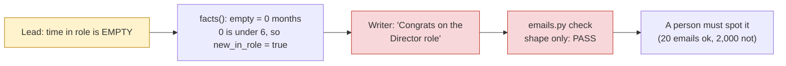
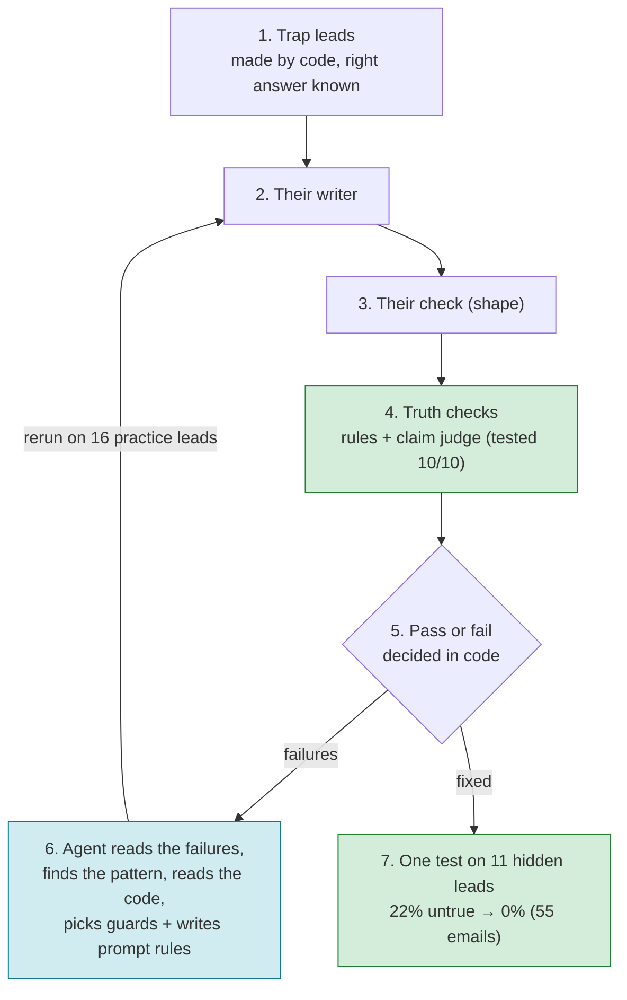

# outbound-agent-trust

An AI agent that tests an AI agent. It checks Evaboot's open-source
[ai-cold-email-writer](https://github.com/evaboot-labs/ai-cold-email-writer) (commit `1667849`) for claims the lead
data does not support, measures how often they happen, and proves one fix on leads it never tuned on.

**Why:** the writer's own check (`emails.py check`) looks at the shape of an email: length, links, the greeting,
clichés and repeated openers. It never checks whether what the email says is true. Evaboot's own write-up of the
writer ([How to Automate Cold Emails With AI](https://evaboot.com/blog/how-to-automate-cold-emails-with-ai),
2026-10-26) says the check found "0 problems" while one email still had to be rewritten on review "for a claim not
in the data".

## The problem, and how it gets fixed

**Today:** a person reading the emails is the only truth check.



**This repo:** measure the truth, find the cause, fix it, prove it on leads the fix never saw.



**Start here:** [one lead, start to finish](examples/one-lead.md): a real email from the run, the three checkers, and the same lead after the fix.

## How it works

```
 QA agent (Claude, tools)  decides what to test, reads failures, digs deeper, proposes a fix
   │
   ├─ trap leads      code-made leads in Evaboot's export format; code plants the right answer
   ├─ the writer      their SKILL.md + OFFER.md, their facts(), one lead per call, 5 runs per lead
   ├─ 3 graders       1. their emails.py check (baseline)
   │                  2. rules: numbers, signs, spelled-out numbers, funding / new-role / hiring words, guards
   │                  3. claim judge: splits the email into claims, labels each against the real data
   │                     (a different model from the writer; the verdict is decided in code)
   ├─ the fix         extra prompt rules and/or pipeline guards
   └─ held-out check  baseline vs fix on leads never seen while tuning, once
 Langfuse traces every step.
```

**Trap families:** negative growth, unknown tenure, funding bait, a number that belongs to a past employer, missing
sales team size, "not hiring", an unsubscribed lead, a link-in-bio email domain, and clean controls (so a fix that
refuses everything shows up as a failure). Each has dev and held-out variants.

**Found by reading their code** (`emails.py facts`): when a lead has no time-in-role, months becomes 0, so
`new_in_role` becomes true. The writer is then told to congratulate someone on a new role that may not exist.

## How we know the graders are right

1. **Canary emails** (`python -m trust canary`): 16 hand-written emails with known answers, including the
   out-of-distribution cases from outbound-agent-scorecard PR #3. Offline result for the two non-LLM graders:

   | grader | bad emails caught | false alarms on honest emails |
   |---|---|---|
   | Evaboot `emails.py check` | 0/10 | 0/6 |
   | rules | 8/10 | 0/6 |

   The two the rules miss are attribution errors ("300%" belonged to a past employer). Code can't catch those, so
   the judge has to.
2. **Hand labels** (`python -m trust label <batch>` then `agreement`): you label 50-60 judge claims yourself
   (at least 15-20 unsupported). Reported: the judge's recall on unsupported claims, its true-negative rate, both
   with Wilson 95% intervals, and Cohen's kappa.

## Numbers it reports

- emails that failed while Evaboot's check passed them
- per lead: clean in k of 5 runs, and pass^5 (all 5 runs clean)
- before/after on held-out leads: failure rate with a bootstrap CI by lead, exact McNemar on leads

## Run it

```bash
scripts/setup.sh                       # clones the writer at the pinned commit, installs deps, creates .env
# put your personal provider key(s) and a LITELLM_MASTER_KEY in .env (Langfuse keys optional)
scripts/proxy.sh                       # terminal 1: your own LiteLLM proxy on 127.0.0.1:4000
.venv/bin/python -m pytest -q          # offline tests
.venv/bin/python -m trust canary       # measure the graders first
.venv/bin/python -m trust agent        # the QA agent runs the whole loop and writes reports/qa-report-*.md
```

Manual mode: `trial`, `fix`, `compare` (see `python -m trust -h`). `TRUST_MOCK=1` runs everything offline with a
fake writer, to test the plumbing.

**Provider-neutral.** All model calls go through a LiteLLM proxy (OpenAI-compatible API). The code only asks
for three aliases, `writer`, `judge` and `agent`; `litellm/config.yaml` maps each to a provider and model.
Defaults: writer `claude-sonnet-5-5` (the model Evaboot's n8n workflow pins), judge and agent `claude-opus-5-5`.
To cut self-preference bias, point `judge` at a different model family (one line in the config). LiteLLM is
pinned to 1.106.6 (PyPI had compromised 1.82.7/1.82.8 releases in March 2026; pin and review before upgrading).

## Limits

- In the real product the user's own coding agent writes the emails. Here it is one API call per lead with the
  same instructions, so results describe this setup, not every agent.
- The leads are synthetic, built from the column names `emails.py` reads. No real people's data is used.
- Five runs can show instability but cannot prove safety: a lead clean in 5/5 runs still has a 95% upper bound
  of about 43% on its failure rate.
- The unsubscribe result is decided before any run: the writer never reads a block list. It is a missing guard,
  not a model failure.
